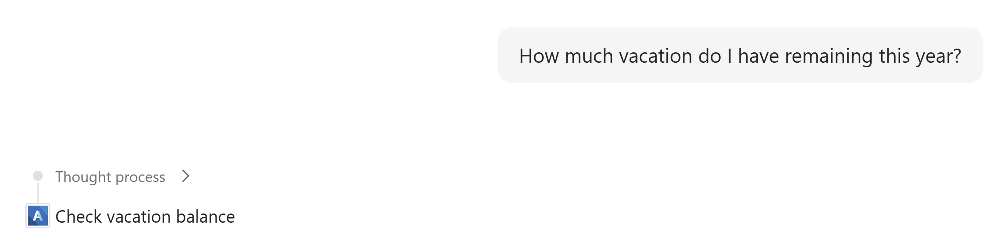
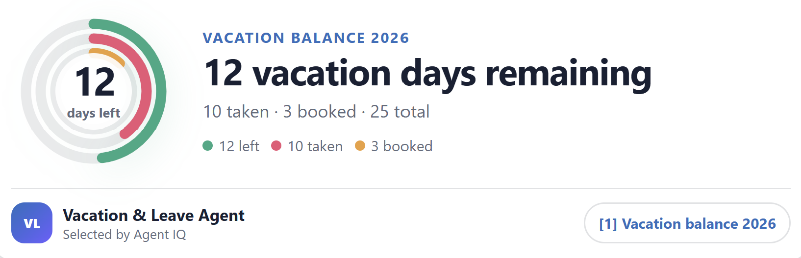
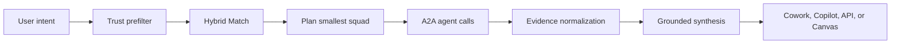

# Agent IQ

> **One prompt. The right AI team. Every step proven.**

Agent IQ discovers the smallest trusted squad of AI agents for a request,
invokes them through A2A, and returns one grounded result with citations and a
replayable execution record.

[](https://github.com/micromobs/agent-iq/actions/workflows/verify.yml)
[](https://www.python.org/)
[](https://a2a-protocol.org/)

Agent IQ is an early preview. The local experience is credential-free and
deterministic. Azure deployment creates billable resources and currently uses
an anonymous Cowork connector suitable only for personal/demo environments.

## See it locally

On Windows with PowerShell 7, [Git](https://git-scm.com/),
[uv](https://docs.astral.sh/uv/getting-started/installation/), and
[Node.js 24](https://nodejs.org/) installed:

```powershell
git clone https://github.com/micromobs/agent-iq.git
Set-Location .\agent-iq
pwsh .\scripts\agent-iq.ps1 demo
```

This installs the locked dependencies and opens the credential-free Employee
Operations showcase. It demonstrates intent matching, dynamic single- and
multi-agent formation, compact progress, evidence, citations, partial failure,
and approval boundaries without contacting Azure.

Run the deterministic quality suite:

```powershell
pwsh .\scripts\agent-iq.ps1 test
```

The discovery, orchestration, and tool-selection release bars are all 1.000.





You have 12 vacation days remaining for 2026: 25 total, 10 taken, and 3 already booked. (Source: Vacation & Leave Agent, balance as of 14 July 2026.)

*Synthetic local example: Agent IQ selects one eligible specialist and keeps the
answer, provenance, and source on one compact surface.*

## Deploy an isolated anonymous demo to your own Azure subscription

After installing the Azure prerequisites below, one command provisions an
isolated, personal demo environment in a subscription you own:

```powershell
pwsh .\scripts\agent-iq.ps1 deploy -AllowAnonymousDemoConnector
```

> [!WARNING]
> This deploys an anonymous demo connector suitable only for an isolated,
> personal environment with synthetic data. `-AllowAnonymousDemoConnector`
> records your explicit acknowledgment of that boundary; it does not make the
> endpoint production-safe. See [Preview limitations](#preview-limitations)
> and [SECURITY.md](SECURITY.md) before deploying.

The command diagnoses prerequisites, signs in when needed, shows a cost warning,
provisions the Azure foundation, deploys the hosted A2A fleet and orchestrator,
builds tenant-specific Cowork and Copilot packages, and runs live scenario
probes.

Preview the exact resource plan without changing Azure:

```powershell
pwsh .\scripts\agent-iq.ps1 deploy -Plan -SubscriptionId <subscription-id>
```

Deployment state and generated host packages are written outside the repository:

```text
%LOCALAPPDATA%\AgentIQ\environments\dev\
```

See [Deploy to Azure](docs/DEPLOY_TO_AZURE.md) for roles, resource inventory,
cost controls, troubleshooting, and teardown.

### Azure prerequisites

| Requirement | Minimum |
| --- | --- |
| PowerShell | 7.4 |
| Azure CLI | 2.80 |
| Azure Developer CLI | 1.27 |
| Docker | Docker Desktop with a running Linux engine |
| Azure access | Enabled subscription; resource creation and role-assignment permission |
| Entra access | Permission to create an application, or a pre-created companion app ID |
| Capacity | Foundry model availability and quota in the selected region |

Check the machine and current Azure sessions:

```powershell
pwsh .\scripts\agent-iq.ps1 doctor -Cloud
```

## Install the generated package in Cowork

For a personal developer install:

```powershell
atk install --file-path `
  "$env:LOCALAPPDATA\AgentIQ\environments\dev\agent-iq.zip" `
  --scope Personal
```

Start a fresh Cowork conversation, select Agent IQ, and try:

```text
My VPN is down.
How much vacation do I have remaining this year?
Which enzymes power BrightWash Cold cleaning?
```

The package contains atomic workflow skills. Each skill calls the same generic
orchestration path; no scenario hard-codes the participating agents.

See [Install in Cowork](docs/INSTALL_IN_COWORK.md) and
[Certified scenarios](docs/SCENARIOS.md).

## Use the generated GitHub Copilot plugin

The repository copy under `packages\copilot` contains an intentionally
nonfunctional endpoint template. Load only the tenant-specific copy generated by
`deploy` or `package`:

```powershell
copilot `
  --plugin-dir "$env:LOCALAPPDATA\AgentIQ\environments\dev\copilot\agent-iq-plugin" `
  --agent agent-iq:agent-iq
```

## How it works



1. **Catalog** normalizes agents, skills, MCP servers, capabilities, health, and
   trust metadata.
2. **Trust** removes ineligible candidates before any lexical or semantic
   ranking.
3. **Match** combines BM25, semantic retrieval, reciprocal-rank fusion, and
   deterministic selection.
4. **Orchestrate** decomposes work, selects the smallest justified squad, and
   builds a dependency DAG.
5. **Runtime** negotiates each Agent Card and invokes cloud agents through
   native A2A.
6. **Evidence** binds claims to invocation-scoped sources and preserves partial
   failure honestly.
7. **Canvas** projects public lifecycle facts without exposing hidden model
   reasoning.

The current catalog includes 24 example agents across product and employee
operations. The architecture is provider-neutral: adding an eligible agent is a
metadata operation, not a new route in the orchestrator.

## Operate or remove an environment

```powershell
pwsh .\scripts\agent-iq.ps1 status
pwsh .\scripts\agent-iq.ps1 test
pwsh .\scripts\agent-iq.ps1 package -PluginVersion 1.0.1
pwsh .\scripts\agent-iq.ps1 destroy
```

`destroy` deletes the dedicated Azure resource group and removes the
artifact-companion Entra application only when Agent IQ created it.

## Preview limitations

- The automated cloud path is validated by parser, plan, package, and deployment
  contract tests; a new-subscription live certification is still required for
  each Azure region and quota profile.
- Cowork connector authorization is `None` in the developer package. Do not use
  it for production or sensitive tenant data.
- Caller identity is self-asserted (request headers, message metadata, or a
  fixed connector identity), not derived from an authenticated, validated
  principal token.
- Execution read, SSE streaming, and cancel are authorized by execution ID
  only; there is no per-caller or per-tenant binding on those operations.
- The anonymous demo ingress has no request rate limiting or throttling.
- Execution history is retained unbounded in process memory, with no cap or
  eviction.
- Foundry incoming A2A currently uses blocking `message/send`; do not infer
  southbound token streaming when an Agent Card advertises `streaming=false`.
- Vacation, VPN, and selected enterprise-system examples use conspicuously
  labelled synthetic fixtures; no live enterprise connector or production
  certification is included.
- Windows 11 is the currently certified developer and deployment host.

Before any production use, the following are required and not yet delivered:
authenticated principal/tenant identity (not self-asserted), per-caller and
per-tenant authorization on execution access, request quotas and rate limits,
bounded and lifecycle-managed retention, and audit plus live enterprise
certification. See [SECURITY.md](SECURITY.md) for the full preview security
boundary.

## Documentation

| Guide | Purpose |
| --- | --- |
| [Deploy to Azure](docs/DEPLOY_TO_AZURE.md) | One-command provisioning, roles, cost, operations, cleanup |
| [Install in Cowork](docs/INSTALL_IN_COWORK.md) | Personal and admin installation, updates, auth boundary |
| [Scenarios](docs/SCENARIOS.md) | Prompts, expected squads, evidence, and UX |
| [Architecture](docs/architecture/overview.md) | Catalog, Match, Trust, Orchestrate, Runtime, and Evidence |
| [Contracts](docs/architecture/contracts.md) | Versioned public data contracts |
| [Contributing](CONTRIBUTING.md) | Development workflow and release gates |
| [Security](SECURITY.md) | Reporting vulnerabilities and deployment guidance |

## Contributing

Read [AGENTS.md](AGENTS.md), then run:

```powershell
pwsh .\scripts\agent-iq.ps1 install
pwsh .\scripts\verify.ps1
```

The core invariant is strict: **intent and trust form the squad dynamically**.
Do not add fixed agent pairs, composite scenario skills, or hidden fallback
routes.

## License

Licensed under the [MIT License](LICENSE).
